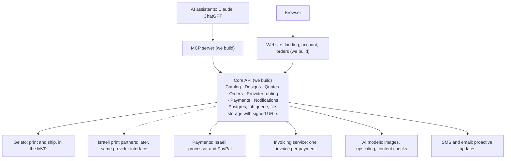
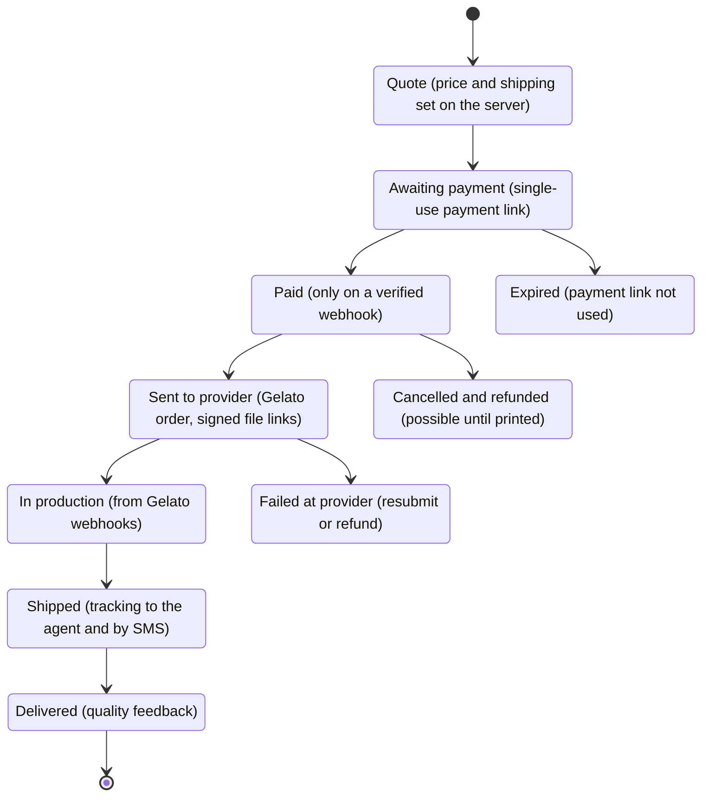

# Technical Spec: Chat-Native Print Store (MVP)

Oct 7, 2026 · @dod

> Source of truth for this repo. Exported from the living spec doc: https://claude.ai/code/artifact/5643d4d6-99f5-4bed-bba4-68337682f58c — when the two differ, update both.

## Summary and scope

We are building our own print store that customers operate from inside their AI assistant. The customer designs, previews, orders, tracks and contacts support through our MCP connector; only the payment step opens a hosted page. Gelato prints and ships for now, behind a provider interface that will later route Israeli orders to local print shops.

**In scope (MVP):** a canonical catalog built on Gelato products (a small canvas and posters first, then a short book in a fixed format), designs (upload and AI generation), print-readiness checks, mockups, quotes, orders, payment, tracking, invoices, support tickets, and a simple website on the same API.

**Moved to Later:** merchant apps for Shopify and Wix (verified notes are kept in the Later section), a dashboard for Israeli print partners, a public developer API, and T-shirts (only with designs created in our own tool).

**Why not a Shopify store as the backend:** every order carries a unique customer design, which fits Shopify's fixed product-and-variant model poorly. A small core of our own plus an Israeli processor's hosted payment page is simpler, and avoids Shopify's extra fee on third-party payment gateways.

**What Shopify already offers, and why it doesn't replace us:** every Shopify store exposes a [built-in MCP server](https://shopify.dev/docs/apps/build/storefront-mcp/servers/storefront) that lets agents search the catalog, manage a cart and get a checkout link. It does not create designs, check print readiness, render mockups, create one-off products, or track production and shipping. Our value is the design-to-print flow inside the chat, not agent access to a store.

## Architecture

The MCP server and the website are thin clients of the same Core API. Business logic, prices and permissions live only in the Core, and only the Core talks to external services.

## Data model

Ten entities cover the MVP. Every amount is an integer in minor units (agorot, cents) stored with a currency code, and every order ID is random, never sequential.

| Entity | Key fields | Notes |
| --- | --- | --- |
| User | id, phone, email, name, saved addresses, generations used this month, bonus generations | Signs in through OAuth with an SMS code |
| CatalogProduct | our SKU, type, variants (size, color), print areas, file requirements, retail price, Gelato `productUid` per variant | The canonical catalog. Swapping the provider doesn't change it |
| Design | id, owner, source (upload / which assistant / generated), prompt if given, rights attestation, file in private storage (for books: ordered pages and a cover), prepared print file per product and size, pixel size, DPI at print size, check result, findings, mockups | Gelato gets a signed link, never the file itself |
| Quote | id, items, destination country, product price, shipping price, tax, total, currency, expiry | Prices are set only on the server |
| Order | id, channel (mcp / web), user, shipping address, status, totals, provider, provider order ID | States in the next section |
| OrderItem | id, variant, design, quantity, unit price, provider item reference |  |
| Payment | id, order, processor, amount, currency, status, processor reference, invoice | Confirmed only by a verified webhook |
| Shipment | order, carrier, tracking number, tracking URL, delivery date range, status | Updated from Gelato webhooks |
| SupportTicket | id, order, user, message, channel, status | Can be opened from the chat |
| EventLog | id, source, type, payload, received at, processed at | Every webhook is stored before processing |

## Order lifecycle

Every state change comes from a verified event: the processor's webhook up to Paid, and Gelato's webhooks from there on.

## Core API

An internal REST API that both the MCP server and the website call. Every POST carries an `Idempotency-Key` header, and every call checks that the resource belongs to the authenticated user.

| Endpoint | What it does |
| --- | --- |
| `GET /v1/catalog` | Products, variants and prices per destination country |
| `POST /v1/designs` | Creates a design: returns a signed upload URL, or generates an image from a prompt |
| `POST /v1/designs/{id}/check` | Checks resolution, aspect ratio, transparency and protected content |
| `POST /v1/designs/{id}/mockups` | Renders mockups on the product |
| `POST /v1/quotes` | Price, shipping options and delivery window (wraps Gelato's quote) |
| `POST /v1/orders` | Creates an order from a quote and returns a payment link |
| `GET /v1/orders`, `GET /v1/orders/{id}` | List, status, tracking and invoice |
| `POST /v1/orders/{id}/cancel` | Cancels, only before production |
| `POST /v1/support` | Opens a support ticket |
| `POST /v1/designs/{id}/prepare` | Upscales, crops or fits, and converts color for a chosen product and size; returns the print-file preview |

**Inbound webhooks:** each one is stored in EventLog, verified, and processed by a background queue.

- `/hooks/payments/{processor}`: payment confirmation, verified with the processor's signature.
- `/hooks/gelato`: status and tracking updates. Gelato documents no signature, so we use a secret header of our own and re-fetch the order with GET before acting.

## MCP connector

A remote MCP server whose tools all call the Core API. It holds no business logic of its own: prices, permissions and limits live in the Core.

**Transport and version**

- Streamable HTTP on a single endpoint. The latest spec version is [2026-07-28](https://modelcontextprotocol.io/specification/2026-07-28/changelog), which drops sessions and the initialize handshake. We have not verified which version Claude and ChatGPT speak today, so we also support 2025-11-25.
- SDK: `@modelcontextprotocol/server` (v2) with a Node adapter, and `@modelcontextprotocol/ext-apps` for mockup cards.
- Validate the `Origin` header on every request and return 403 when it is invalid.

**Auth (OAuth 2.1)**

- The server publishes Protected Resource Metadata at `/.well-known/oauth-protected-resource`, pointing to our authorization server.
- The authorization server supports Client ID Metadata Documents and Dynamic Client Registration, with PKCE (S256). [Claude supports both](https://claude.com/docs/connectors/building/authentication); its redirect URI is `https://claude.ai/api/mcp/auth_callback`.
- Sign-in screen: phone number plus SMS code. The first sign-in creates the User.
- Validate the audience of every token. Tokens never travel in the URL.

**Tools**

Every tool has a `title` and `readOnlyHint` or `destructiveHint`, a name of at most 64 characters, and reads and writes live in separate tools, per [Claude's directory criteria](https://claude.com/docs/connectors/building/review-criteria).

| Tool | Kind | What it does |
| --- | --- | --- |
| `list_products` | read | Products, sizes, colors and prices per country |
| `create_upload_link` | write | Signed upload URL for the customer's own image |
| `generate_design` | write | Generates an image from a prompt, directly at print resolution. Required in Claude, which doesn't generate images itself; optional in other assistants. Counts against the monthly quota |
| `check_design` | read | Resolution at print size, aspect ratio, transparency and protected content. Returns what to fix |
| `preview_product` | read | Mockup on the product: an MCP App card, plus a plain image for clients without card support |
| `get_quote` | read | Price, shipping options and delivery window |
| `create_order` | write | Creates the order and returns a payment-page link. It never charges by itself |
| `list_orders` | read | The user's orders with status |
| `get_order` | read | Status, tracking number, delivery window and invoice link |
| `cancel_order` | destructive | Cancels, only before production |
| `reorder` | write | New order from a saved design, with a new payment link |
| `contact_support` | write | Opens a support ticket tied to an order |
| `submit_feedback` | write | Rating and comment after delivery. Feeds quality tracking per provider |
| `prepare_for_print` | write | Prepares a design for a product and size: upscale, crop or fit, color conversion. Returns the print preview and what changed |
| `get_print_specs` | read | Aspect ratio, minimum and target pixel size, safe area, and bleed or wrap for each product and size |

**Getting images in**

The user chooses the path. Whatever arrives, `preview_product` shows exactly the file we received, on the product, and the person approves it again on the checkout page.

- **Our generator** (`generate_design`): counts against the quota below. In Claude it is the only way to create an image inside the chat.
- **Upload button inside the mockup card:** the MCP App card posts the file straight to our upload URL (declared in `connectDomains`), so the image never passes through the model.
- **Upload link** (`create_upload_link`): the fallback for clients without card support.
- **Images made in the user's own assistant** (ChatGPT, Gemini): the model can't reliably pass an image's bytes in a tool call, so these come in through the upload button or link unless the client offers a file-passing feature. Free for us.

**Generation quota**

- X generations a month per account. Accounts are verified by phone, which makes duplicate accounts harder.
- Every order adds N generations for the rest of that month. Paid generation packs can come later.
- Previews are generated at low resolution. Only the ordered image is upscaled to print resolution, at order time.
- Set X and N after measuring the cost of one preview: X previews is what we accept spending on a user who hasn't bought yet; N previews must stay a small share of the margin on an order.

**Print preparation (before payment)**

Images from chats are often too small for the print size, so every design is prepared for the chosen product and size before the quote, and the result goes back to the chat for approval.

1. **Measure:** pixel size, effective DPI at the chosen size, aspect ratio, color profile and transparency. Example: a 1024 × 1024 image on a 30 × 30 cm canvas is about 87 DPI, below Gelato's 150 DPI minimum.
2. **Upscale** with a super-resolution model when DPI is below target. In the example, 2× gives about 173 DPI and 4× about 347. Then check the result for artifacts.
3. **Fit:** when the aspect ratio doesn't match, offer a crop, a fit with a border, or AI extension of the edges. For canvas, include the wrapped edges.
4. **Color:** convert to sRGB.
5. **Show it back:** `prepare_for_print` returns the prepared preview as an image in the tool result and in the mockup card, with what changed (upscale factor, crop). The user approves it in the chat, and again on the checkout page.
6. **Be honest about limits:** if the image can't reach acceptable quality at the chosen size, say so and suggest the largest size that works.

We keep both the original and the print file sent to Gelato. Upscaling runs once per chosen size, not for every preview.

**Guidance to the assistant**

We tell the assistant how to make a printable image, so the user starts at a supported size and ratio. Our check and print preparation still run on every design.

- **`get_print_specs` (read tool):** for each product and size, the aspect ratio, the minimum and target pixel size, the safe area, and bleed or canvas wrap. Example: 30 × 30 cm needs about 1772 × 1772 px at 150 DPI and 3543 × 3543 px at 300 DPI. The assistant calls it before creating, and the data always matches the live catalog.
- **Tool descriptions:** short, factual rules the model reads when choosing a tool: pick the product and size first, generate at the matching aspect ratio, keep the subject and any text inside the safe area, original content only.
- **Server instructions:** a brief summary of the flow, for clients that pass them to the model.
- **Scope:** guidance covers only our tools and never tells the assistant to override the user or other tools.

Guidance fixes aspect ratio and composition, not resolution: image generators in chats usually produce images smaller than print size, so upscaling stays part of print preparation.

**Mockup cards (MCP Apps)**

- The tool declares `_meta.ui.resourceUri: "ui://..."`, and the resource is served as `text/html;profile=mcp-app` ([spec](https://modelcontextprotocol.io/extensions/apps/overview)).
- Mockup images are served from a domain listed in `resourceDomains`. Claude does not allow embedding third-party iframes.
- A "Pay" button in the card opens the payment page through `ui/open-link`; Claude asks the user to confirm before opening it.
- Every tool also returns plain-text `content`, for clients that don't render cards.

**Payment**

- `create_order` returns a single-use link to our checkout page (Israeli processor or PayPal), always as plain text, and also through URL-mode elicitation when the client supports it.
- The spec forbids asking for payment details in an in-chat form ([elicitation](https://modelcontextprotocol.io/specification/2026-07-28/client/elicitation)), and no tool charges money by itself.

**Proactive updates:** SMS or email when the order is paid, shipped and delivered. The agent answers status questions only when asked.

## Website and trust

The website is a thin client on the same Core API. Its first job is trust: showing that a real business stands behind the chat.

**Pages**

- **Landing page:** what the store does, a short video of ordering from inside the chat, real photos of printed products, and instructions for adding the connector to Claude and ChatGPT.
- **Account:** sign-in with an SMS code; orders, tracking and invoices. The same account the connector uses.
- **Web design flow (optional in the MVP):** upload, check, mockup, quote and pay, for people who don't use an AI assistant.
- **Legal pages:** terms of use, privacy policy, shipping policy, returns and reprint policy, and a content policy (no protected characters or brands).
- **Business details in the footer:** business name, Israeli business registration number, address, phone and support email.

**Checkout:** our checkout page, which hands off to the Israeli processor's hosted page or to PayPal. Hyp, for example, offers Bit, Apple Pay and Google Pay. After paying, the customer returns to an order page on our domain and gets a confirmation by SMS or email.

**Support:** one inbox that receives tickets from the chat (`contact_support`) and from the site. Every ticket is tied to an order.

## Fulfillment and routing

Every provider implements one interface: `quote`, `createOrder`, `cancelOrder`, `getOrder`, and a translation of its webhooks into uniform Core events. In the MVP every order goes to Gelato. Later: an Israeli destination plus a local partner that makes the SKU goes to the partner; everything else goes to Gelato.

**Gelato calls**

- Auth with the `X-API-KEY` header ([docs](https://dashboard.gelato.com/docs/)).
- Create order: [`POST https://order.gelatoapis.com/v4/orders`](https://dashboard.gelato.com/docs/orders/v4/create/). `orderReferenceId` is our order ID, `customerReferenceId` is our user ID, and `currency` accepts ILS among others. Each item has `productUid`, `quantity`, and `files[]` with `url` and `type` (`front`, `back`, and so on).
- Shipping address limits: first and last name up to 25 characters, address line up to 35, city up to 30; postcode, country code and email are required. Truncate and validate on our side before sending.
- Quote: [`POST /v4/orders:quote`](https://developers.gelato.com/docs/orders/v4/quote) returns, per production facility, the price, shipping methods and delivery date range.
- Cancel: `POST /v4/orders/{id}:cancel`. Returns 409 once the order has been printed.
- Catalog, prices, stock and shipping methods: `product.gelatoapis.com/v3/...` and `shipment.gelatoapis.com/v1/shipment-methods`. Cache them, because the default limit is 5,000 calls a day.

**Gelato webhooks**

- Events: `order_status_updated`, `order_item_tracking_code_updated`, `order_delivery_estimate_updated` ([docs](https://dashboard.gelato.com/docs/webhooks/)).
- No documented signature: set a secret header in the webhook configuration, and re-fetch the order with GET before acting.
- Gelato retries 3 times, 5 seconds apart, so return 2xx immediately and process in the queue.
- Order statuses we act on: `passed`, `in_production`, `printed`, `shipped`, `in_transit`, `delivered`, `failed`, `canceled`, `returned`.

**Print files**

- T-shirts: transparent PNG or JPEG, at least 150 DPI at print size and 300 recommended, sRGB ([guide](https://support.gelato.com/en/articles/8996354)).
- Posters: PDF/X-4 or PNG, 150 to 300 DPI, with 4 mm bleed ([guide](https://support.gelato.com/en/articles/8996349)).
- Gelato downloads the file from its URL: use a signed link valid for at least 7 days.

**Terms:** under the [API terms](https://www.gelato.com/legal/api-terms), the API may be used to integrate our own application, and end customers ordering through it is the intended use. That covers this MVP, where we are the seller.

## Payments, invoices and tax

Payments go through a provider interface in the Core, like fulfillment: `createCheckout`, `getPayment`, `refund`, and webhook verification. The MVP runs two providers side by side, and adding Stripe later means a new adapter, not a rewrite. An order counts as paid only after a verified webhook, never because the agent says so.

| Provider | Role | Notes |
| --- | --- | --- |
| Israeli processor (for example Hyp, Grow, Tranzila, CardCom or PayPlus) | Cards, plus Bit, Apple Pay and Google Pay where offered | Hosted payment page, saved-card tokens, refunds and webhooks by API. Confirm foreign cards and USD/EUR before signing |
| [PayPal](https://www.paypal.com/il/webapps/mpp/merchant-fees) | Second option, mainly for buyers abroad | Orders API. Israeli business account: 3.40% plus a fixed fee per payment, +1% from the US, Canada and Europe or +2% from elsewhere, and 2.5% on currency conversion |
| Stripe (later) | Main processor once there is a US company | [Not available to Israeli businesses](https://stripe.com/global). Needs a US entity and an accountant's review |

No merchant-of-record service covers us. [Lemon Squeezy](https://docs.lemonsqueezy.com/help/getting-started/prohibited-products), [Stripe Managed Payments](https://stripe.com/managed-payments) and [Airwallex](https://www.airwallex.com/docs/payments/merchant-of-record.md) support digital products only, and [Shopify Managed Markets](https://changelog.shopify.com/posts/shopify-managed-markets-now-available-in-canada-and-the-uk) (run by Global-e) is open only to merchants in a few countries. Tax stays with us, as with any small print store.

- **Checkout page:** `create_order` returns a single-use, expiring link to our own checkout page, which offers both providers. The link carries no personal data.
- **Immediate charge:** Gelato has no partner-acceptance step, so we charge right away. Pre-authorization holds (J5) come in with Israeli partners.
- **Cancellation:** before production, cancel at Gelato, then refund through the same provider.
- **Currency:** shekels for Israeli destinations, dollars or euros abroad.
- **Markets at launch:** Israel plus a short list of countries, widened after the accountant meeting.
- **Invoices:** an Israeli invoicing service with an API that supports allocation numbers. Every payment produces an invoice; the link goes out by SMS or email and is returned by `get_order`.
- **Tax:** Israeli VAT on Israeli sales. Abroad, Gelato prints near the buyer, so a sale may count as a domestic sale in the buyer's country (in the EU, for example). That is the main question for the accountant.

## Content rights

We are the seller and the manufacturer, so an infringing design is our liability, and [Gelato's API terms](https://www.gelato.com/legal/api-terms) place responsibility for the content we send on us. Our exposure is closer to a personal print lab than to a marketplace: orders are private, for the customer, with no public listings. That lowers the risk but doesn't remove it. This is our working design, not legal advice.

**How the big players handle it:** marketplaces still get sued. [Redbubble faced years of litigation](https://www.ragtrader.com.au/news/redbubble-court-battles-reach-final-showdown) over user designs, including a 2021 jury award of US$520,000 that went back on appeal. Printful runs an [IP registry](https://www.printful.com/ip-registry): rights holders upload their marks, an AI moderation tool screens orders against them, and matching orders are rejected. Printify [blocks products](https://help.printify.com/hc/en-us/articles/13625711755409-Why-is-my-product-blocked-for-Intellectual-Property-infringement) on rights-holder complaints or internal risk flags. Both say no system catches everything.

**Our layers, regardless of where a design comes from:**

1. **Guidance to the assistant:** tool descriptions say original designs only, with no characters, brands, logos or famous people. The assistant reads this while it designs.
2. **Provenance record per design:** source (upload, or which assistant generated it), the prompt if one was given, time, and user.
3. **Automated screening in `check_design`:** a vision model looks for logos, known characters and celebrity faces; text recognition looks for brand names. The result is pass, flag or reject, with a reason code and a suggestion the assistant can act on.
4. **Human attestation at checkout:** on our checkout page, the person (not the agent) confirms they hold the rights, including consent from anyone pictured. The terms of use add an indemnity.
5. **Manual review:** during the beta, every design is reviewed between Paid and Sent to provider. Later, only flagged designs. A rejected order is refunded in full.
6. **Notice and takedown:** a published contact for rights holders, a response process, and blocking repeat infringers.
7. **No public gallery** of customer designs without a separate review and the customer's consent.

**Before public launch:** an IP lawyer reviews the terms of use, the indemnity, the takedown process, and likeness rights for photos of real people.

## Security and operations

The principle: the agent is untrusted input. Anything that decides money, permissions or content is checked on the server.

- **Secrets:** API keys in a secret manager.
- **Webhooks:** verify every source (the processor's signature; for Gelato, a secret header plus a re-fetch). Store each event in EventLog before processing, and make processing idempotent.
- **Authorization:** every call checks that the order or design belongs to the authenticated user. Knowing an ID is not authorization.
- **Limits:** the monthly generation quota per user, and a daily cap on orders.
- **Content:** handled as described in Content rights.
- **Privacy:** keep only what shipping and invoicing need, with a defined retention period. Photos of children for books require explicit consent at upload and are deleted after delivery.
- **Monitoring:** alert when an order sits in one state longer than expected, and reconcile daily against Gelato and the processor.
- **Measurement:** funnel events from connector added to design, preview, checkout, paid and delivered, plus generation cost per user. This is how we judge the launch gate and find where people drop off.

## Recommended stack

TypeScript throughout, because the official MCP SDK is written in it. Specific commercial vendors are still open.

| Layer | Choice | Notes |
| --- | --- | --- |
| Core API | Node with TypeScript | One monorepo for every component |
| MCP server | `@modelcontextprotocol/server` v2 and `@modelcontextprotocol/ext-apps` | [Official SDK](https://github.com/modelcontextprotocol/typescript-sdk) |
| Website | Any TypeScript web framework, served from the same deployment | Landing, account and order pages |
| Database | Postgres | Can also host the job queue at first |
| Files | S3-compatible storage with signed URLs | Designs, mockups and print files |
| Images | An image-generation model with upscaling, and a vision model for content checks | Vendor to choose |
| Mockups | Server-side compositing of the design onto product templates | For example an image library such as sharp |
| SMS and email | A provider that supports Israeli numbers |  |

## Build order

First a thin slice that runs end to end, then widen. Each milestone is accepted only with a real order.

**Start now, in parallel with code:** choose a name and domain, register the business and open a business bank account, open the payment processor and PayPal accounts (onboarding in Israel can take weeks), open a Gelato account, order a sample small canvas and poster to an Israeli address to check quality and delivery time, and meet an accountant.

1. **Thin slice.** One product (a small canvas), upload only (the design comes from the user's own assistant or files), resolution check, rights attestation and manual review of every design, a simple mockup image, quote, payment link in the processor's sandbox, Gelato order, and status through `get_order`, all from Claude through a custom connector.
   - **Accept:** a real canvas, ordered entirely from inside Claude, arrives at an Israeli address, and every state change is recorded from webhooks.
2. **Designs.** AI generation inside the connector, so Claude users create images without leaving the chat; the monthly generation quota; the content check; the MCP App mockup card with its upload button; and posters.
   - **Accept:** a low-resolution file is rejected with a clear fix, a known logo is held for manual review, and the card renders in Claude and in ChatGPT.
3. **Short book.** One fixed format (one size, a fixed page count, one page template), a renderer that assembles pages and a cover into a print-ready PDF, and an import flow for a story already made in the user's assistant.
   - **Accept:** a real book, created and ordered entirely from inside Claude, arrives with correct margins, cover and spine.
4. **Website and invoices.** Landing page, legal pages, account page, invoicing integration, SMS and email updates.
   - **Accept:** the invoice link arrives by SMS after payment, and the account page shows the same orders as the chat.
5. **Private beta** with 10 to 20 people.
   - **Accept:** each tester completes an order without help, and every problem is logged and triaged.
6. **Public launch:** submissions to the Claude and ChatGPT directories, and a demo video.
   - **Gate to keep going:** 10 paid orders from people who don't know you.

**Development setup:** build against Gelato draft orders (`orderType: draft`, nothing goes to production) and the processor's sandbox, and expose the MCP server through a temporary public HTTPS URL so it can be added to Claude as a custom connector.

## Open questions

**Before public launch**

- [ ] Claude's connector directory: is a connector that creates paid orders accepted, when the payment itself happens on our page?
- [ ] Accountant: tax on sales abroad.
- [ ] IP lawyer: terms of use, indemnity, takedown process, and likeness rights for photos of real people.

**Technical**

- [ ] Which MCP version Claude and ChatGPT speak today, and which elicitation modes they support.
- [ ] Whether an upload button inside the MCP App card works in Claude (web, desktop, mobile) and ChatGPT, and whether any client can pass a chat image straight to a tool.
- [ ] Gelato: whether the address can be patched on an order, whether file links must be public, canvas file requirements (wrapped edges), and book cover dimensions per page count.

**Business**

- [ ] Processor: multiple currencies, foreign cards, Bit and Apple Pay, approval time. When a US company and Stripe start to pay off.
- [ ] Price list: Gelato cost per canvas and poster size, plus shipping and margin, per currency.
- [ ] Image and upscaling models: vendor, cost per preview and per upscale, and terms that allow commercial use of the output.
- [ ] Returns and reprint policy, aligned with Gelato's claim window so we never promise more than Gelato covers.
- [ ] Languages: English and Hebrew for the site, checkout, emails and SMS.

## Later: merchant apps for Shopify and Wix

A different product from the MVP: a fulfillment app that other stores install, like Printful. It only makes sense once Israeli print partners give us something the big players lack. These notes were verified against the platforms' docs on October 7, 2026, so the work doesn't need repeating.

**Blockers to clear first**

- **Gelato:** its terms allow the API for our own application only, with no documented way to act for other merchants and no sublicensing without written consent. Routing merchants' orders to Gelato needs that consent.
- **Wix billing:** [app guidelines](https://dev.wix.com/docs/build-apps/launch-your-app/app-distribution/app-market-guidelines) require Wix Billing for any app that collects money, unless Wix approves an exception. The exception is a [Partner Billed App](https://dev.wix.com/docs/build-apps/launch-your-app/pricing-and-billing/partner-billed-apps-reporting.md), which reports every charge and shares revenue ([100% to us in year one, 80% after, minus a 2.5% fee](https://dev.wix.com/docs/build-apps/launch-your-app/pricing-and-billing/about-monetizing-your-app.md)). The deciding question: is product and shipping cost excluded from the shared revenue?

**Shopify app**

- Build with `shopify app init` and the React Router template, GraphQL Admin API only. Distribute as a public app tested on development stores; a custom app can't use the Billing API and can't become public later.
- Register as a fulfillment service with `fulfillmentServiceCreate` (`callbackUrl`, `trackingSupport: true`). Orders arrive as `FULFILLMENT_REQUEST` notifications at `<callbackUrl>/fulfillment_order_notification`; accept with `fulfillmentOrderAcceptFulfillmentRequest`; write tracking back with `fulfillmentCreate`.
- Scopes: `write_products`, `write_files`, `write_inventory`, `write_fulfillments`, `read_assigned_fulfillment_orders`, `write_assigned_fulfillment_orders`, plus [Level 2 protected customer data](https://shopify.dev/docs/apps/launch/protected-customer-data) to read shipping addresses.
- Mandatory privacy webhooks: `customers/data_request`, `customers/redact`, `shop/redact`.
- Billing: [requirement 5.5.3](https://shopify.dev/docs/apps/launch/shopify-app-store/app-store-requirements) lets product-sourcing apps charge the cost of goods through a PCI-compliant gateway; any other fee must go through the Billing API.

**Wix app**

- A self-managed app with a dashboard page loaded as an iframe. Tokens via `client_credentials` with `instance_id`, valid for 4 hours.
- Support both catalog versions: check `GetCatalogVersion`, then create products with `POST /stores/v3/products` or `POST /stores/v1/products`.
- Orders arrive with the [Order Approved](https://dev.wix.com/docs/api-reference/business-solutions/e-commerce/orders/orders/order-approved.md) event; tracking goes back with [Create Fulfillment](https://dev.wix.com/docs/api-reference/business-solutions/e-commerce/orders/order-fulfillments/create-fulfillment.md).

## Sources

**MCP and Claude**

- [MCP changelog, version 2026-07-28](https://modelcontextprotocol.io/specification/2026-07-28/changelog)
- [MCP elicitation](https://modelcontextprotocol.io/specification/2026-07-28/client/elicitation)
- [MCP Apps overview](https://modelcontextprotocol.io/extensions/apps/overview)
- [MCP TypeScript SDK](https://github.com/modelcontextprotocol/typescript-sdk)
- [Claude: connector authentication](https://claude.com/docs/connectors/building/authentication)
- [Claude: connector directory criteria](https://claude.com/docs/connectors/building/review-criteria)

**Gelato**

- [API docs](https://dashboard.gelato.com/docs/)
- [Create order](https://dashboard.gelato.com/docs/orders/v4/create/)
- [Quote](https://developers.gelato.com/docs/orders/v4/quote)
- [Webhooks](https://dashboard.gelato.com/docs/webhooks/)
- [T-shirt print files](https://support.gelato.com/en/articles/8996354)
- [Poster print files](https://support.gelato.com/en/articles/8996349)
- [API terms](https://www.gelato.com/legal/api-terms)

**Shopify**

- [Storefront MCP server](https://shopify.dev/docs/apps/build/storefront-mcp/servers/storefront)
- [Scaffold an app](https://shopify.dev/docs/apps/build/scaffold-app)
- [Fulfillment service apps](https://shopify.dev/docs/apps/build/orders-fulfillment/fulfillment-service-apps/build-for-fulfillment-services)
- [Protected customer data](https://shopify.dev/docs/apps/launch/protected-customer-data)
- [App Store requirements](https://shopify.dev/docs/apps/launch/shopify-app-store/app-store-requirements)

**Wix**

- [App Market guidelines](https://dev.wix.com/docs/build-apps/launch-your-app/app-distribution/app-market-guidelines)
- [Partner Billed Apps](https://dev.wix.com/docs/build-apps/launch-your-app/pricing-and-billing/partner-billed-apps-reporting.md)
- [App monetization](https://dev.wix.com/docs/build-apps/launch-your-app/pricing-and-billing/about-monetizing-your-app.md)
- [Order Approved](https://dev.wix.com/docs/api-reference/business-solutions/e-commerce/orders/orders/order-approved.md)
- [Create Fulfillment](https://dev.wix.com/docs/api-reference/business-solutions/e-commerce/orders/order-fulfillments/create-fulfillment.md)
